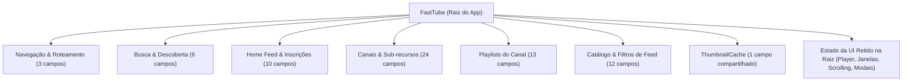
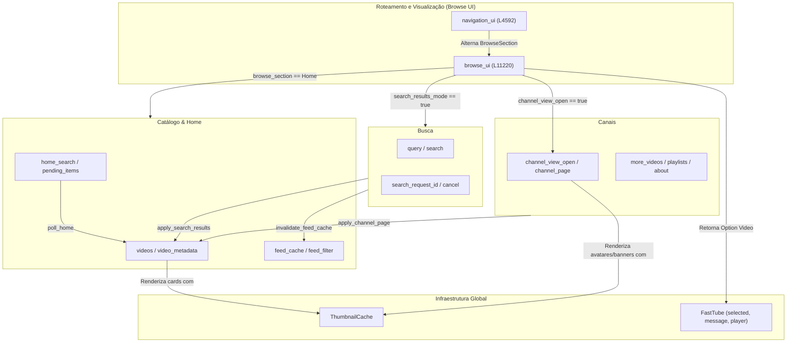

# Arquitetura e Fronteira de Estado: Descoberta, Canais e Navegação de `FastTube`

**Data de elaboração:** 12/11/2026  
**Repositório:** [`FastTube`](file:///D:/Fastube)  
**Alvo de análise:** [`src/main.rs`](file:///D:/Fastube/src/main.rs)  
**Ferramentas utilizadas:** Graphify v0.9.106 (AST estrutural, 1.297 nós, 3.679 relações, 68 comunidades) e inspeção estática direta do código-fonte.

---

## 1. Visão Geral e Contexto Arquitetural

No estado atual de [`src/main.rs:823-973`](file:///D:/Fastube/src/main.rs#L823-L973), a struct central [`FastTube`](file:///D:/Fastube/src/main.rs#L823) atua como um agregador monolítico composto por **148 campos**, ultrapassando 12.200 linhas de código no arquivo principal.

A fronteira de **Descoberta, Canais e Navegação** concentra **69 campos** (aproximadamente **46,6%** de todo o estado da aplicação), sendo responsável pelo fluxo de localização de conteúdo, paginação de canais, exploração de playlists, gestão de filtros de feed, cache de miniaturas e roteamento de seções.



---

## 2. Levantamento e Agrupamento dos Campos

Os 69 campos mapeados dividem-se em 7 grupos funcionais dentro de [`FastTube`](file:///D:/Fastube/src/main.rs#L823):

| Grupo | Quantidade de Campos | Linhas em [`src/main.rs`](file:///D:/Fastube/src/main.rs) | Responsabilidade Principal |
| :--- | :---: | :---: | :--- |
| **Catálogo & Metadados** | 3 | L825–L827 | Coleção ativa de vídeos em memória, controle de geração e cache de metadados enriquecidos. |
| **Busca** | 6 | L824, L831–L832, L851–L852, L896 | Consulta textual, canais de comunicação com `yt-dlp`, IDs de correlação assíncrona e modo de resultados. |
| **Home & Inscrições** | 10 | L833–L834, L843–L850 | Feed inicial público/privado, paginação de inscrições, títulos da grade e lista de URLs de playlists da home. |
| **Canais (Geral, Mais Vídeos, Sobre)** | 24 | L853–L870, L884–L889 | Modelo do canal atual, estado visual, paginação em lote ("carregar mais vídeos"), aba Sobre e cancelamento. |
| **Playlists Públicas de Canal** | 13 | L871–L883 | Listagem de playlists do canal, playlist selecionada, itens da playlist e canais assíncronos dedicados. |
| **Thumbnails & Texturas** | 1 | L830 | Gestão do ciclo de vida de texturas egui, carregamento sob demanda e liberação de cache visual. |
| **Navegação & Roteamento** | 3 | L895, L969, L970 | Seção atual do browse, gaveta lateral expandida/colapsada e acordeão de inscrições. |
| **Filtros & Preferências de Feed** | 9 | L928–L933, L966–L968 | Critérios de exclusão (assistidos, shorts, lives), ordenação, filtro selecionado e cache derivado de ranking. |

---

## 3. Mapeamento Exaustivo: Campos e Métodos de Acesso

Abaixo está o mapeamento completo de cada campo, sua linha de declaração, seu tipo exato e a lista de todos os métodos que o acessam com suas respectivas linhas de início e linhas de ocorrência.

### 3.1. Grupo: Catálogo & Metadados

1. **`videos: Vec<Video>`** ([`src/main.rs:825`](file:///D:/Fastube/src/main.rs#L825))
   - Tipo: [`Vec<search::Video>`](file:///D:/Fastube/src/search.rs#L113)
   - Métodos acessores:
     - `video_for_history_entry` (início [L2018](file:///D:/Fastube/src/main.rs#L2018), acesso: L2020)
     - `reset_channel_tabs_state` (início [L2261](file:///D:/Fastube/src/main.rs#L2261), acessos: L2265, L2271)
     - `apply_search_results` (início [L2308](file:///D:/Fastube/src/main.rs#L2308), acessos: L2315, L2350, L2378)
     - `ensure_feed_cache` (início [L2388](file:///D:/Fastube/src/main.rs#L2388), acessos: L2402, L2404)
     - `apply_channel_page` (início [L2418](file:///D:/Fastube/src/main.rs#L2418), acesso: L2423)
     - `begin_channel_request` (início [L2452](file:///D:/Fastube/src/main.rs#L2452), acesso: L2483)
     - `complete_channel_playlists` (início [L2726](file:///D:/Fastube/src/main.rs#L2726), acesso: L2751)
     - `begin_channel_playlist_videos_request` (início [L2767](file:///D:/Fastube/src/main.rs#L2767), acesso: L2787)
     - `close_channel_public_playlist` (início [L2835](file:///D:/Fastube/src/main.rs#L2835), acesso: L2846)
     - `clear_visual_caches` (início [L3407](file:///D:/Fastube/src/main.rs#L3407), acessos: L3408, L3410)
     - `poll_home` (início [L3735](file:///D:/Fastube/src/main.rs#L3735), acesso: L3791)
     - `header_recommendation_ui` (início [L4296](file:///D:/Fastube/src/main.rs#L4296), acesso: L4316)
     - `settings_panel_feed_ui` (início [L5158](file:///D:/Fastube/src/main.rs#L5158), acesso: L5178)
     - `results_feed_ui` (início [L9457](file:///D:/Fastube/src/main.rs#L9457), acessos: L9468, L9491)
     - `search_results_ui` (início [L10313](file:///D:/Fastube/src/main.rs#L10313), acessos: L10315, L10347, L10381)
     - `watch_sidebar_feed_ui` (início [L10528](file:///D:/Fastube/src/main.rs#L10528), acesso: L10536)
     - `browse_ui` (início [L11220](file:///D:/Fastube/src/main.rs#L11220), acesso: L11244)
     - `browse_home_content_ui` (início [L11629](file:///D:/Fastube/src/main.rs#L11629), acessos: L11637, L11649)

2. **`feed_data_generation: u64`** ([`src/main.rs:826`](file:///D:/Fastube/src/main.rs#L826))
   - Tipo: `u64` (marcador monotônico de modificação do catálogo)
   - Métodos acessores:
     - `apply_search_results` (início [L2308](file:///D:/Fastube/src/main.rs#L2308), acesso: L2379)
     - `ensure_feed_cache` (início [L2388](file:///D:/Fastube/src/main.rs#L2388), acessos: L2392, L2410)
     - `results_feed_ui` (início [L9457](file:///D:/Fastube/src/main.rs#L9457), acessos: L9467, L9490)
     - `search_results_ui` (início [L10313](file:///D:/Fastube/src/main.rs#L10313), acessos: L10346, L10380)

3. **`video_metadata: HashMap<String, VideoMetadata>`** ([`src/main.rs:827`](file:///D:/Fastube/src/main.rs#L827))
   - Tipo: `HashMap<String, search::VideoMetadata>`
   - Métodos acessores:
     - `metadata_for` (início [L2183](file:///D:/Fastube/src/main.rs#L2183), acesso: L2184)
     - `apply_search_results` (início [L2308](file:///D:/Fastube/src/main.rs#L2308), acessos: L2366, L2380)
     - `ensure_feed_cache` (início [L2388](file:///D:/Fastube/src/main.rs#L2388), acessos: L2402, L2405)
     - `apply_channel_page` (início [L2418](file:///D:/Fastube/src/main.rs#L2418), acessos: L2431, L2435)
     - `complete_channel_more_videos` (início [L2602](file:///D:/Fastube/src/main.rs#L2602), acessos: L2641, L2661)
     - `complete_channel_playlist_videos` (início [L2861](file:///D:/Fastube/src/main.rs#L2861), acessos: L2888, L2892)
     - `settings_panel_feed_ui` (início [L5158](file:///D:/Fastube/src/main.rs#L5158), acesso: L5179)

---

### 3.2. Grupo: Busca

1. **`query: String`** ([`src/main.rs:824`](file:///D:/Fastube/src/main.rs#L824))
   - Métodos acessores:
     - `begin_search_request` (início [L3345](file:///D:/Fastube/src/main.rs#L3345), acesso: L3346)
     - `start_public_home` (início [L3394](file:///D:/Fastube/src/main.rs#L3394), acesso: L3403)
     - `header_search_ui` (início [L4215](file:///D:/Fastube/src/main.rs#L4215), acessos: L4243, L4247, L4253, L4264)
     - `header_recommendation_ui` (início [L4296](file:///D:/Fastube/src/main.rs#L4296), acesso: L4319)
     - `filter_chips_bar_ui` (início [L9496](file:///D:/Fastube/src/main.rs#L9496), acesso: L9612)
     - `explore_section_ui` (início [L11121](file:///D:/Fastube/src/main.rs#L11121), acesso: L11214)
     - `open_library_bookmark` (início [L11533](file:///D:/Fastube/src/main.rs#L11533), acesso: L11535)

2. **`search: Option<Receiver<SearchFetchMessage>>`** ([`src/main.rs:831`](file:///D:/Fastube/src/main.rs#L831))
   - Métodos acessores:
     - `complete_search_request` (início [L3376](file:///D:/Fastube/src/main.rs#L3376), acesso: L3386)
     - `start_public_home` (início [L3394](file:///D:/Fastube/src/main.rs#L3394), acesso: L3395)
     - `start_search` (início [L3419](file:///D:/Fastube/src/main.rs#L3419), acesso: L3429)
     - `start_browser_feed` (início [L3438](file:///D:/Fastube/src/main.rs#L3438), acesso: L3448)
     - `poll_search` (início [L3860](file:///D:/Fastube/src/main.rs#L3860), acessos: L3862, L3872)
     - `handle_header_home` (início [L4193](file:///D:/Fastube/src/main.rs#L4193), acesso: L4210)
     - `header_recommendation_ui` (início [L4296](file:///D:/Fastube/src/main.rs#L4296), acesso: L4316)
     - `navigation_primary_ui` (início [L4592](file:///D:/Fastube/src/main.rs#L4592), acesso: L4617)
     - `compact_navigation_ui` (início [L4994](file:///D:/Fastube/src/main.rs#L4994), acesso: L5018)
     - `filter_chips_bar_ui` (início [L9496](file:///D:/Fastube/src/main.rs#L9496), acesso: L9611)
     - `search_results_ui` (início [L10313](file:///D:/Fastube/src/main.rs#L10313), acesso: L10318)
     - `watch_sidebar_feed_ui` (início [L10528](file:///D:/Fastube/src/main.rs#L10528), acesso: L10537)

3. **`search_cancel: Option<process::Cancellation>`** ([`src/main.rs:832`](file:///D:/Fastube/src/main.rs#L832))
   - Métodos acessores:
     - `start_search` (início [L3419](file:///D:/Fastube/src/main.rs#L3419), acessos: L3424, L3428)
     - `start_browser_feed` (início [L3438](file:///D:/Fastube/src/main.rs#L3438), acesso: L3445)
     - `on_exit` (início [L12442](file:///D:/Fastube/src/main.rs#L12442), acesso: L12444)

4. **`search_request_id: u64`** ([`src/main.rs:851`](file:///D:/Fastube/src/main.rs#L851))
   - Métodos acessores:
     - `begin_search_request` (início [L3345](file:///D:/Fastube/src/main.rs#L3345), acessos: L3356, L3357)

5. **`active_search_request_id: Option<u64>`** ([`src/main.rs:852`](file:///D:/Fastube/src/main.rs#L852))
   - Métodos acessores:
     - `begin_search_request` (início [L3345](file:///D:/Fastube/src/main.rs#L3345), acesso: L3358)
     - `complete_search_request` (início [L3376](file:///D:/Fastube/src/main.rs#L3376), acessos: L3382, L3385)
     - `start_browser_feed` (início [L3438](file:///D:/Fastube/src/main.rs#L3438), acesso: L3449)
     - `poll_search` (início [L3860](file:///D:/Fastube/src/main.rs#L3860), acessos: L3868, L3871)

6. **`search_results_mode: bool`** ([`src/main.rs:896`](file:///D:/Fastube/src/main.rs#L896))
   - Métodos acessores:
     - `start_public_home` (início [L3394](file:///D:/Fastube/src/main.rs#L3394), acesso: L3399)
     - `start_browser_feed` (início [L3438](file:///D:/Fastube/src/main.rs#L3438), acesso: L3450)
     - `handle_header_home` (início [L4193](file:///D:/Fastube/src/main.rs#L4193), acessos: L4197, L4203)
     - `header_search_ui` (início [L4215](file:///D:/Fastube/src/main.rs#L4215), acesso: L4285)
     - `header_recommendation_ui` (início [L4296](file:///D:/Fastube/src/main.rs#L4296), acesso: L4312)
     - `navigate_from_shortcut` (início [L4326](file:///D:/Fastube/src/main.rs#L4326), acesso: L4328)
     - `navigation_primary_ui` (início [L4592](file:///D:/Fastube/src/main.rs#L4592), acessos: L4602, L4607, L4634, L4652, L4668)
     - `navigation_subscriptions_ui` (início [L4677](file:///D:/Fastube/src/main.rs#L4677), acesso: L4747)
     - `navigation_shortcuts_ui` (início [L4776](file:///D:/Fastube/src/main.rs#L4776), acessos: L4797, L4820, L4837, L4858)
     - `navigation_utilities_ui` (início [L4871](file:///D:/Fastube/src/main.rs#L4871), acesso: L4889)
     - `navigation_now_playing_ui` (início [L4936](file:///D:/Fastube/src/main.rs#L4936), acesso: L4959)
     - `compact_navigation_ui` (início [L4994](file:///D:/Fastube/src/main.rs#L4994), acessos: L5004, L5010, L5027, L5051, L5068)
     - `filter_chips_bar_ui` (início [L9496](file:///D:/Fastube/src/main.rs#L9496), acesso: L9603)
     - `search_results_ui` (início [L10313](file:///D:/Fastube/src/main.rs#L10313), acesso: L10389)
     - `explore_section_ui` (início [L11121](file:///D:/Fastube/src/main.rs#L11121), acesso: L11212)
     - `browse_ui` (início [L11220](file:///D:/Fastube/src/main.rs#L11220), acesso: L11256)

---

### 3.3. Grupo: Home & Inscrições

1. **`home_search: Option<Receiver<HomeFetchMessage>>`** ([`src/main.rs:833`](file:///D:/Fastube/src/main.rs#L833))
   - Acessos: `open_channel_with_options` (L2507), `begin_search_request` (L3353), `start_public_home` (L3395), `start_browser_feed` (L3439, L3480), `cancel_login` (L3624), `cancel_home_feed` (L3635), `poll_home` (L3738, L3780, L3816, L3826, L3827, L3835), `handle_header_home` (L4210), `header_recommendation_ui` (L4316), `navigation_primary_ui` (L4617), `navigation_subscriptions_ui` (L4706), `navigation_utilities_ui` (L4913), `compact_navigation_ui` (L5018), `filter_chips_bar_ui` (L9562, L9611), `browse_home_content_ui` (L11637).
2. **`home_cancel: Option<process::Cancellation>`** ([`src/main.rs:834`](file:///D:/Fastube/src/main.rs#L834))
   - Acessos: `open_channel_with_options` (L2504), `begin_search_request` (L3350), `start_browser_feed` (L3442, L3478), `cancel_login` (L3621), `cancel_home_feed` (L3632), `poll_home` (L3781, L3817, L3828), `on_exit` (L12454).
3. **`initial_public_home_started: bool`** ([`src/main.rs:843`](file:///D:/Fastube/src/main.rs#L843))
   - Acessos: `ui` (L12480, L12481).
4. **`home_playlist_urls: Vec<String>`** ([`src/main.rs:844`](file:///D:/Fastube/src/main.rs#L844))
   - Acessos: `begin_search_request` (L3355), `start_browser_feed` (L3452), `poll_home` (L3787), `navigation_utilities_ui` (L4920), `video_card_ui` (L7124), `results_feed_ui` (L9479), `youtube_grid_card_ui` (L9632), `home_grid_ui` (L10075), `youtube_search_result_card_ui` (L10157), `search_results_ui` (L10355).
5. **`home_title: Option<String>`** ([`src/main.rs:845`](file:///D:/Fastube/src/main.rs#L845))
   - Acessos: `begin_search_request` (L3354), `start_browser_feed` (L3468), `cancel_login` (L3626), `poll_home` (L3753, L3778, L3792, L3796, L3807), `navigation_shortcuts_ui` (L4833, L4834), `navigation_utilities_ui` (L4919), `filter_chips_bar_ui` (L9577).
6. **`home_limit_reached: bool`** ([`src/main.rs:846`](file:///D:/Fastube/src/main.rs#L846))
   - Acessos: `start_browser_feed` (L3453), `cancel_login` (L3627), `poll_home` (L3760, L3762, L3789).
7. **`subscription_channels: Vec<search::HomeChannel>`** ([`src/main.rs:847`](file:///D:/Fastube/src/main.rs#L847))
   - Acessos: `poll_home` (L3756, L3783), `navigation_subscriptions_ui` (L4694), `navigation_utilities_ui` (L4922).
8. **`subscription_channels_loaded: bool`** ([`src/main.rs:848`](file:///D:/Fastube/src/main.rs#L848))
   - Acessos: `poll_home` (L3757, L3784), `navigation_subscriptions_ui` (L4705), `navigation_utilities_ui` (L4923).
9. **`subscription_channels_error: Option<String>`** ([`src/main.rs:849`](file:///D:/Fastube/src/main.rs#L849))
   - Acessos: `start_browser_feed` (L3456), `poll_home` (L3758, L3785, L3810), `navigation_subscriptions_ui` (L4720), `navigation_utilities_ui` (L4924).
10. **`pending_home_items: Vec<SearchResult>`** ([`src/main.rs:850`](file:///D:/Fastube/src/main.rs#L850))
    - Acessos: `start_browser_feed` (L3454), `cancel_login` (L3625), `cancel_home_feed` (L3636, L3637), `poll_home` (L3761, L3775, L3812, L3813, L3829, L3830), `navigation_utilities_ui` (L4921).

---

### 3.4. Grupo: Canais (Geral, Mais Vídeos, Sobre)

1. **`channel_page: Option<ChannelPage>`** ([`src/main.rs:853`](file:///D:/Fastube/src/main.rs#L853))
   - Acessos: `video_for_history_entry` (L2025), `metadata_for` (L2198), `current_channel_target` (L2304), `apply_search_results` (L2319, L2352), `apply_channel_page` (L2419, L2449), `begin_channel_request` (L2464, L2466, L2480, L2487), `begin_channel_more_videos_request` (L2540, L2544), `complete_channel_more_videos` (L2629), `complete_channel_about` (L2976), `channel_section_ui` (L7730).
2. **`channel_view_open: bool`** ([`src/main.rs:854`](file:///D:/Fastube/src/main.rs#L854))
   - Acessos: `apply_search_results` (L2314, L2348), `begin_channel_request` (L2476), `close_channel_view` (L3089), `begin_search_request` (L3359), `handle_header_home` (L4195), `navigation_primary_ui` (L4600, L4629, L4647, L4664), `navigation_shortcuts_ui` (L4794, L4799, L4810, L4849), `compact_navigation_ui` (L5002, L5039), `watch_sidebar_results_ui` (L10582), `browse_ui` (L11227).
3. **`channel_tab: ChannelTab`** ([`src/main.rs:855`](file:///D:/Fastube/src/main.rs#L855))
   - Acessos: `reset_channel_tabs_state` (L2275), `channel_section_ui` (L7905, L7920, L7930, L7937, L7949, L7973).
4. **`channel_search: Option<Receiver<ChannelFetchMessage>>`** ([`src/main.rs:856`](file:///D:/Fastube/src/main.rs#L856))
   - Acessos: `cancel_channel_loading` (L2297), `open_channel_with_options` (L2523), `complete_channel_request` (L3048), `close_channel_view` (L3092), `begin_search_request` (L3370), `poll_channel` (L3897).
5. **`channel_cancel: Option<process::Cancellation>`** ([`src/main.rs:857`](file:///D:/Fastube/src/main.rs#L857))
   - Acessos: `cancel_channel_loading` (L2292), `open_channel_with_options` (L2518, L2522), `close_channel_view` (L3085), `begin_search_request` (L3365), `on_exit` (L12447).
6. **`channel_request_id: u64`** ([`src/main.rs:858`](file:///D:/Fastube/src/main.rs#L858))
   - Acessos: `begin_channel_request` (L2469, L2470), `begin_channel_more_videos_request` (L2560, L2561), `begin_channel_playlists_request` (L2682, L2683), `begin_channel_playlist_videos_request` (L2796, L2797), `begin_channel_about_request` (L2916, L2917).
7. **`active_channel_request_id: Option<u64>`** ([`src/main.rs:859`](file:///D:/Fastube/src/main.rs#L859))
   - Acessos: `is_channel_loading` (L2219), `cancel_channel_loading` (L2295), `begin_channel_request` (L2471), `complete_channel_request` (L3041, L3046), `complete_channel_outcome` (L3067), `close_channel_view` (L3090), `begin_search_request` (L3364, L3368), `poll_channel` (L3892, L3895).
8. **`channel_loading_target: Option<ChannelTarget>`** ([`src/main.rs:860`](file:///D:/Fastube/src/main.rs#L860))
   - Acessos: `cancel_channel_loading` (L2296), `current_channel_target` (L2302), `begin_channel_request` (L2472), `complete_channel_request` (L3042, L3047), `complete_channel_outcome` (L3068), `close_channel_view` (L3091), `begin_search_request` (L3369), `poll_channel` (L3896), `channel_section_ui` (L7728).
9. **`channel_last_target: Option<ChannelTarget>`** ([`src/main.rs:861`](file:///D:/Fastube/src/main.rs#L861))
   - Acessos: `current_channel_target` (L2305), `apply_channel_page` (L2447), `begin_channel_request` (L2467, L2473).
10. **`channel_error: Option<String>`** ([`src/main.rs:862`](file:///D:/Fastube/src/main.rs#L862))
    - Acessos: `apply_channel_page` (L2448), `begin_channel_request` (L2458, L2474), `open_channel_for_metadata` (L3025), `complete_channel_request` (L3054), `poll_channel` (L3893), `channel_section_ui` (L7729).
11. **`channel_video_limit: usize`** ([`src/main.rs:863`](file:///D:/Fastube/src/main.rs#L863))
    - Acessos: `open_channel_with_options` (L2525), `channel_section_ui` (L7733, L8008).
12. **`channel_from_cache: bool`** ([`src/main.rs:864`](file:///D:/Fastube/src/main.rs#L864))
    - Acessos: `complete_channel_outcome` (L3074, L3078), `channel_section_ui` (L7732).
13. **`channel_more_videos_search: Option<Receiver<ChannelMoreVideosFetchMessage>>`** ([`src/main.rs:865`](file:///D:/Fastube/src/main.rs#L865))
    - Acessos: `cancel_channel_subrequests` (L2242), `load_more_channel_videos` (L2578), `cancel_channel_more_videos` (L2598), `complete_channel_more_videos` (L2617, L2622), `poll_channel_more_videos` (L3922).
14. **`channel_more_videos_cancel: Option<process::Cancellation>`** ([`src/main.rs:866`](file:///D:/Fastube/src/main.rs#L866))
    - Acessos: `cancel_channel_subrequests` (L2239), `load_more_channel_videos` (L2572, L2576), `cancel_channel_more_videos` (L2595), `complete_channel_more_videos` (L2618, L2623), `poll_channel_more_videos` (L3923).
15. **`active_channel_more_videos_request_id: Option<u64>`** ([`src/main.rs:867`](file:///D:/Fastube/src/main.rs#L867))
    - Acessos: `is_channel_more_videos_loading` (L2223), `cancel_channel_subrequests` (L2243), `begin_channel_more_videos_request` (L2562), `cancel_channel_more_videos` (L2599), `complete_channel_more_videos` (L2608, L2616, L2621), `poll_channel_more_videos` (L3917, L3921).
16. **`channel_more_videos_error: Option<String>`** ([`src/main.rs:868`](file:///D:/Fastube/src/main.rs#L868))
    - Acessos: `reset_channel_tabs_state` (L2276), `apply_channel_page` (L2446), `begin_channel_request` (L2475), `begin_channel_more_videos_request` (L2563), `complete_channel_more_videos` (L2626, L2667), `poll_channel_more_videos` (L3918), `channel_videos_tab_ui` (L8035).
17. **`channel_videos_has_more: bool`** ([`src/main.rs:869`](file:///D:/Fastube/src/main.rs#L869))
    - Acessos: `reset_channel_tabs_state` (L2277), `apply_channel_page` (L2444), `begin_channel_more_videos_request` (L2548, L2556), `complete_channel_more_videos` (L2627, L2633, L2648), `channel_videos_tab_ui` (L8036).
18. **`channel_videos_reached_max: bool`** ([`src/main.rs:870`](file:///D:/Fastube/src/main.rs#L870))
    - Acessos: `reset_channel_tabs_state` (L2278), `apply_channel_page` (L2443, L2445), `begin_channel_more_videos_request` (L2547, L2555), `complete_channel_more_videos` (L2628, L2632, L2647), `channel_videos_tab_ui` (L8037).
19. **`channel_about: Option<search::ChannelAboutInfo>`** ([`src/main.rs:884`](file:///D:/Fastube/src/main.rs#L884))
    - Acessos: `reset_channel_tabs_state` (L2286), `complete_channel_about` (L3011), `channel_about_tab_ui` (L8679).
20. **`channel_about_loaded: bool`** ([`src/main.rs:885`](file:///D:/Fastube/src/main.rs#L885))
    - Acessos: `reset_channel_tabs_state` (L2287), `open_channel_with_options` (L2514), `complete_channel_about` (L3012), `channel_section_ui` (L7961).
21. **`channel_about_search: Option<Receiver<ChannelAboutFetchMessage>>`** ([`src/main.rs:886`](file:///D:/Fastube/src/main.rs#L886))
    - Acessos: `cancel_channel_subrequests` (L2257), `start_channel_about` (L2933), `cancel_channel_about` (L2952), `complete_channel_about` (L2967, L2972), `poll_channel_about` (L4007).
22. **`channel_about_cancel: Option<process::Cancellation>`** ([`src/main.rs:887`](file:///D:/Fastube/src/main.rs#L887))
    - Acessos: `cancel_channel_subrequests` (L2254), `start_channel_about` (L2927, L2931), `cancel_channel_about` (L2949), `complete_channel_about` (L2968, L2973), `poll_channel_about` (L4008).
23. **`active_channel_about_request_id: Option<u64>`** ([`src/main.rs:888`](file:///D:/Fastube/src/main.rs#L888))
    - Acessos: `is_channel_about_loading` (L2235), `cancel_channel_subrequests` (L2258), `begin_channel_about_request` (L2918), `cancel_channel_about` (L2953), `complete_channel_about` (L2962, L2966, L2971), `poll_channel_about` (L4002, L4006).
24. **`channel_about_error: Option<String>`** ([`src/main.rs:889`](file:///D:/Fastube/src/main.rs#L889))
    - Acessos: `reset_channel_tabs_state` (L2288), `open_channel_with_options` (L2515), `begin_channel_about_request` (L2919), `complete_channel_about` (L3013, L3016), `poll_channel_about` (L4003), `channel_section_ui` (L7963), `channel_about_tab_ui` (L8678).

---

### 3.5. Grupo: Playlists Públicas do Canal

1. **`channel_playlists: Vec<search::ChannelPlaylist>`** ([`src/main.rs:871`](file:///D:/Fastube/src/main.rs#L871))
   - Acessos: `reset_channel_tabs_state` (L2263, L2279), `complete_channel_playlists` (L2747, L2756), `channel_section_ui` (L7913), `channel_playlists_list_ui` (L8472).
2. **`channel_playlists_loaded: bool`** ([`src/main.rs:872`](file:///D:/Fastube/src/main.rs#L872))
   - Acessos: `reset_channel_tabs_state` (L2280), `open_channel_with_options` (L2512), `complete_channel_playlists` (L2757), `channel_section_ui` (L7912, L7953), `channel_playlists_list_ui` (L8471).
3. **`channel_playlists_search: Option<Receiver<ChannelPlaylistsFetchMessage>>`** ([`src/main.rs:873`](file:///D:/Fastube/src/main.rs#L873))
   - Acessos: `cancel_channel_subrequests` (L2247), `start_channel_playlists` (L2699), `cancel_channel_playlists` (L2722), `complete_channel_playlists` (L2738, L2743), `poll_channel_playlists` (L3952).
4. **`channel_playlists_cancel: Option<process::Cancellation>`** ([`src/main.rs:874`](file:///D:/Fastube/src/main.rs#L874))
   - Acessos: `cancel_channel_subrequests` (L2244), `start_channel_playlists` (L2693, L2697), `cancel_channel_playlists` (L2719), `complete_channel_playlists` (L2739, L2744), `poll_channel_playlists` (L3953).
5. **`active_channel_playlists_request_id: Option<u64>`** ([`src/main.rs:875`](file:///D:/Fastube/src/main.rs#L875))
   - Acessos: `is_channel_playlists_loading` (L2227), `cancel_channel_subrequests` (L2248), `begin_channel_playlists_request` (L2684), `cancel_channel_playlists` (L2723), `complete_channel_playlists` (L2733, L2737, L2742), `poll_channel_playlists` (L3947, L3951).
6. **`channel_playlists_error: Option<String>`** ([`src/main.rs:876`](file:///D:/Fastube/src/main.rs#L876))
   - Acessos: `reset_channel_tabs_state` (L2281), `open_channel_with_options` (L2513), `begin_channel_playlists_request` (L2685), `complete_channel_playlists` (L2758, L2761), `poll_channel_playlists` (L3948), `channel_section_ui` (L7955), `channel_playlists_list_ui` (L8470).
7. **`channel_selected_playlist: Option<search::ChannelPlaylist>`** ([`src/main.rs:877`](file:///D:/Fastube/src/main.rs#L877))
   - Acessos: `reset_channel_tabs_state` (L2282), `begin_channel_playlist_videos_request` (L2795), `close_channel_public_playlist` (L2843), `channel_playlists_tab_ui` (L8166).
8. **`channel_playlist_videos: Vec<SearchResult>`** ([`src/main.rs:878`](file:///D:/Fastube/src/main.rs#L878))
   - Acessos: `metadata_for` (L2206), `reset_channel_tabs_state` (L2269, L2283), `apply_search_results` (L2342, L2359), `begin_channel_playlist_videos_request` (L2785, L2791), `close_channel_public_playlist` (L2844, L2850), `complete_channel_playlist_videos` (L2896), `channel_playlist_detail_ui` (L8434, L8440).
9. **`channel_playlist_videos_loaded: bool`** ([`src/main.rs:879`](file:///D:/Fastube/src/main.rs#L879))
   - Acessos: `reset_channel_tabs_state` (L2284), `begin_channel_playlist_videos_request` (L2792), `close_channel_public_playlist` (L2842), `complete_channel_playlist_videos` (L2897), `channel_playlist_detail_ui` (L8422).
10. **`channel_playlist_videos_search: Option<Receiver<ChannelPlaylistVideosFetchMessage>>`** ([`src/main.rs:880`](file:///D:/Fastube/src/main.rs#L880))
    - Acessos: `cancel_channel_subrequests` (L2252), `open_channel_public_playlist` (L2815), `close_channel_public_playlist` (L2839), `cancel_channel_playlist_videos` (L2857), `complete_channel_playlist_videos` (L2878, L2883), `poll_channel_playlist_videos` (L3982).
11. **`channel_playlist_videos_cancel: Option<process::Cancellation>`** ([`src/main.rs:881`](file:///D:/Fastube/src/main.rs#L881))
    - Acessos: `cancel_channel_subrequests` (L2249), `begin_channel_playlist_videos_request` (L2782), `open_channel_public_playlist` (L2813), `close_channel_public_playlist` (L2836), `cancel_channel_playlist_videos` (L2854), `complete_channel_playlist_videos` (L2879, L2884), `poll_channel_playlist_videos` (L3983).
12. **`active_channel_playlist_videos_request_id: Option<u64>`** ([`src/main.rs:882`](file:///D:/Fastube/src/main.rs#L882))
    - Acessos: `is_channel_playlist_videos_loading` (L2231), `cancel_channel_subrequests` (L2253), `begin_channel_playlist_videos_request` (L2798), `close_channel_public_playlist` (L2840), `cancel_channel_playlist_videos` (L2858), `complete_channel_playlist_videos` (L2868, L2877, L2882), `poll_channel_playlist_videos` (L3977, L3981).
13. **`channel_playlist_videos_error: Option<String>`** ([`src/main.rs:883`](file:///D:/Fastube/src/main.rs#L883))
    - Acessos: `reset_channel_tabs_state` (L2285), `begin_channel_playlist_videos_request` (L2773, L2793), `close_channel_public_playlist` (L2841), `complete_channel_playlist_videos` (L2898, L2901), `poll_channel_playlist_videos` (L3978), `channel_playlist_detail_ui` (L8421).

---

### 3.6. Grupo: Thumbnails & Texturas

1. **`thumbnails: ThumbnailCache`** ([`src/main.rs:830`](file:///D:/Fastube/src/main.rs#L830))
   - Tipo: [`thumbnails::ThumbnailCache`](file:///D:/Fastube/src/thumbnails.rs#L54)
   - Métodos acessores:
     - `apply_search_results` (início [L2308](file:///D:/Fastube/src/main.rs#L2308), acesso: L2349)
     - `clear_visual_caches` (início [L3407](file:///D:/Fastube/src/main.rs#L3407), acesso: L3409 via `.reset(ctx, &current_videos)`)
     - `video_card_ui` (início [L7111](file:///D:/Fastube/src/main.rs#L7111), acesso: L7166)
     - `continue_watching_ui` (início [L7618](file:///D:/Fastube/src/main.rs#L7618), acessos: L7640 `.begin_pass()`, L7652 `.show_rounded()`, L7708 `.end_pass(ctx)`)
     - `channel_section_ui` (início [L7718](file:///D:/Fastube/src/main.rs#L7718), acessos: L7813, L7831)
     - `channel_videos_tab_ui` (início [L8020](file:///D:/Fastube/src/main.rs#L8020), acessos: L8055 `.begin_pass()`, L8144 `.end_pass(ctx)`)
     - `channel_playlist_detail_videos_ui` (início [L8340](file:///D:/Fastube/src/main.rs#L8340), acessos: L8356 `.begin_pass()`, L8387 `.end_pass(ctx)`)
     - `channel_playlists_list_ui` (início [L8456](file:///D:/Fastube/src/main.rs#L8456), acessos: L8546 `.begin_pass()`, L8571 `.show()`, L8654 `.end_pass(ctx)`)
     - `results_feed_ui` (início [L9457](file:///D:/Fastube/src/main.rs#L9457), acessos: L9469 `.begin_pass()`, L9489 `.end_pass(ctx)`)
     - `youtube_grid_card_ui` (início [L9623](file:///D:/Fastube/src/main.rs#L9623), acesso: L9655 `.show_rounded()`)
     - `shorts_shelf_ui` (início [L9784](file:///D:/Fastube/src/main.rs#L9784), acesso: L9836 `.show_rounded()`)
     - `home_grid_ui` (início [L10019](file:///D:/Fastube/src/main.rs#L10019), acessos: L10042 `.begin_pass()`, L10127 `.end_pass(ctx)`)
     - `youtube_search_result_card_ui` (início [L10140](file:///D:/Fastube/src/main.rs#L10140), acesso: L10272)
     - `search_results_ui` (início [L10313](file:///D:/Fastube/src/main.rs#L10313), acessos: L10348 `.begin_pass()`, L10379 `.end_pass(ctx)`)
     - `library_video_section_ui` (início [L11056](file:///D:/Fastube/src/main.rs#L11056), acessos: L11098 `.begin_pass()`, L11117 `.end_pass(ctx)`)
     - `ui` (início [L12471](file:///D:/Fastube/src/main.rs#L12471), acesso: L12487 via `.maintain(&ctx)`)

---

### 3.7. Grupo: Navegação & Roteamento

1. **`browse_section: BrowseSection`** ([`src/main.rs:970`](file:///D:/Fastube/src/main.rs#L970))
   - Tipo: [`BrowseSection`](file:///D:/Fastube/src/main.rs#L721-L731) (`Home`, `Explore`, `Subscriptions`, `Shorts`, `History`, `Queue`, `Library`)
   - Métodos acessores:
     - `start_public_home` (início [L3394](file:///D:/Fastube/src/main.rs#L3394), acesso: L3398)
     - `handle_header_home` (início [L4193](file:///D:/Fastube/src/main.rs#L4193), acessos: L4196, L4202)
     - `header_search_ui` (início [L4215](file:///D:/Fastube/src/main.rs#L4215), acesso: L4286)
     - `header_recommendation_ui` (início [L4296](file:///D:/Fastube/src/main.rs#L4296), acesso: L4311)
     - `navigate_from_shortcut` (início [L4326](file:///D:/Fastube/src/main.rs#L4326), acesso: L4333)
     - `navigation_primary_ui` (início [L4592](file:///D:/Fastube/src/main.rs#L4592), acessos: L4601, L4608, L4630, L4635, L4648, L4653, L4665, L4669)
     - `navigation_subscriptions_ui` (início [L4677](file:///D:/Fastube/src/main.rs#L4677), acesso: L4748)
     - `navigation_shortcuts_ui` (início [L4776](file:///D:/Fastube/src/main.rs#L4776), acessos: L4802, L4809, L4825, L4838, L4848, L4863)
     - `navigation_utilities_ui` (início [L4871](file:///D:/Fastube/src/main.rs#L4871), acessos: L4882, L4894, L4926)
     - `compact_navigation_ui` (início [L4994](file:///D:/Fastube/src/main.rs#L4994), acessos: L5003, L5011, L5023, L5028, L5040, L5052, L5063, L5069)
     - `filter_chips_bar_ui` (início [L9496](file:///D:/Fastube/src/main.rs#L9496), acessos: L9539, L9540, L9599, L9604)
     - `partition_home_feed_videos` (início [L9972](file:///D:/Fastube/src/main.rs#L9972), acesso: L9977)
     - `apply_home_grid_actions` (início [L9992](file:///D:/Fastube/src/main.rs#L9992), acesso: L10002)
     - `explore_section_ui` (início [L11121](file:///D:/Fastube/src/main.rs#L11121), acesso: L11211)
     - `browse_ui` (início [L11220](file:///D:/Fastube/src/main.rs#L11220), acessos: L11237, L11244, L11256, L11260, L11270, L11281)
     - `browse_subscriptions_header_ui` (início [L11336](file:///D:/Fastube/src/main.rs#L11336), acesso: L11337)
     - `is_watch_short_mode` (início [L11985](file:///D:/Fastube/src/main.rs#L11985), acesso: L11987)

2. **`navigation_open: bool`** ([`src/main.rs:895`](file:///D:/Fastube/src/main.rs#L895))
   - Métodos acessores:
     - `open_video` (início [L4015](file:///D:/Fastube/src/main.rs#L4015), acesso: L4089)
     - `close_video` (início [L4102](file:///D:/Fastube/src/main.rs#L4102), acesso: L4114)
     - `header_menu_button_ui` (início [L4148](file:///D:/Fastube/src/main.rs#L4148), acessos: L4149, L4170, L4173)
     - `watch_navigation_drawer_ui` (início [L5078](file:///D:/Fastube/src/main.rs#L5078), acesso: L5108)
     - `ui` (início [L12471](file:///D:/Fastube/src/main.rs#L12471), acessos: L12621, L12635, L12676)

3. **`sidebar_subscriptions_expanded: bool`** ([`src/main.rs:969`](file:///D:/Fastube/src/main.rs#L969))
   - Métodos acessores:
     - `navigation_subscriptions_ui` (início [L4677](file:///D:/Fastube/src/main.rs#L4677), acessos: L4728, L4757, L4762, L4770)

---

### 3.8. Grupo: Filtros & Preferências de Feed

1. **`feed_filter: FeedFilter`** ([`src/main.rs:966`](file:///D:/Fastube/src/main.rs#L966))
   - Acessos: `ensure_feed_cache` (L2393, L2407, L2411), `start_public_home` (L3400, L3403), `handle_header_home` (L4198, L4204), `header_search_ui` (L4287), `header_recommendation_ui` (L4313, L4320), `navigate_from_shortcut` (L4335), `navigation_primary_ui` (L4603, L4609, L4631, L4636), `navigation_shortcuts_ui` (L4803), `navigation_utilities_ui` (L4927), `compact_navigation_ui` (L5005, L5012, L5024, L5029), `filter_chips_bar_ui` (L9518, L9538, L9598, L9609), `partition_home_feed_videos` (L9976), `apply_home_grid_actions` (L10003, L10014), `search_results_ui` (L10390), `explore_section_ui` (L11213), `is_watch_short_mode` (L11986).
2. **`feed_cache_dirty: bool`** ([`src/main.rs:967`](file:///D:/Fastube/src/main.rs#L967))
   - Acessos: `apply_search_results` (L2381), `invalidate_feed_cache` (L2385), `ensure_feed_cache` (L2397, L2415), `clear_visual_caches` (L3412).
3. **`feed_cache: FeedDerivedCache`** ([`src/main.rs:968`](file:///D:/Fastube/src/main.rs#L968))
   - Acessos: `ensure_feed_cache` (L2392–L2414), `start_public_home` (L3402), `header_recommendation_ui` (L4318), `settings_panel_feed_ui` (L5164), `filter_chips_bar_ui` (L9504), `home_grid_ui` (L10021, L10125), `browse_ui` (L11252).
4. **`feed_hide_watched: bool`** ([`src/main.rs:928`](file:///D:/Fastube/src/main.rs#L928))
   - Acessos: `export_user_data` (L7303), `import_user_data` (L7598), `subscription_feed_filter_bar_ui` (L9886), `apply_subscription_feed_filters` (L9939, L9951).
5. **`feed_hide_shorts: bool`** ([`src/main.rs:929`](file:///D:/Fastube/src/main.rs#L929))
   - Acessos: `export_user_data` (L7304), `import_user_data` (L7599), `subscription_feed_filter_bar_ui` (L9889), `apply_subscription_feed_filters` (L9940, L9952).
6. **`feed_hide_lives: bool`** ([`src/main.rs:930`](file:///D:/Fastube/src/main.rs#L930))
   - Acessos: `export_user_data` (L7305), `import_user_data` (L7600), `subscription_feed_filter_bar_ui` (L9892), `apply_subscription_feed_filters` (L9941, L9953).
7. **`feed_newest_first: bool`** ([`src/main.rs:931`](file:///D:/Fastube/src/main.rs#L931))
   - Acessos: `export_user_data` (L7306), `import_user_data` (L7601), `subscription_feed_filter_bar_ui` (L9895), `apply_subscription_feed_filters` (L9942, L9954, L9965).
8. **`feed_channel: Option<String>`** ([`src/main.rs:932`](file:///D:/Fastube/src/main.rs#L932))
   - Acessos: `export_user_data` (L7307), `import_user_data` (L7602), `subscription_feed_filter_bar_ui` (L9904–L9921), `apply_subscription_feed_filters` (L9943, L9955).
9. **`feed_prefs_path: Option<PathBuf>`** ([`src/main.rs:933`](file:///D:/Fastube/src/main.rs#L933))
   - Acessos: `user_data_paths` (L7270), `apply_subscription_feed_filters` (L9937).

---

## 4. Relações e Acoplamentos entre os Grupos

O grafo gerado pelo Graphify revela fortes pontos de intersecção entre os subsistemas:



### Acoplamentos críticos identificados no AST:
1. **Busca → Catálogo & Cache:** Ao receber resultados assíncronos (`apply_search_results` [L2308](file:///D:/Fastube/src/main.rs#L2308)), atualiza `videos`, insere metadados em `video_metadata`, incrementa `feed_data_generation` e define `feed_cache_dirty = true`.
2. **Canais → Sub-requisições em Cascata:** Abrir um canal via `open_channel_with_options` ([L2498](file:///D:/Fastube/src/main.rs#L2498)) ou fechar via `close_channel_view` ([L3084](file:///D:/Fastube/src/main.rs#L3084)) dispara cancelamentos coordenados em cascata: `cancel_channel_loading` ([L2291](file:///D:/Fastube/src/main.rs#L2291)) e `cancel_channel_subrequests` ([L2238](file:///D:/Fastube/src/main.rs#L2238)), afetando simultaneamente os 5 pares de canais `Receiver` + `Cancellation`.
3. **Navegação → Roteador e Watch Mode:** Em `ui` ([L12619-L12675](file:///D:/Fastube/src/main.rs#L12619-L12675)), o estado `selected: Option<Video>` comanda a alternância raiz entre `watch_page_ui` e `browse_page_ui` (que chama `browse_ui`). O roteador `browse_ui` retorna `Option<Video>`; ao selecionar um vídeo, a raiz assume a transição de estado.
4. **Thumbnails como Serviço Global:** `thumbnails: ThumbnailCache` não pertence a nenhuma tela individual: é referenciado por 16 métodos distintos espalhados por cards de busca, grade da home, banners de canais, playlists e biblioteca.

---

## 5. Structs Propostas para Decomposição

Para extrair e encapsular os 69 campos sem comprometer as garantias do Rust (`borrow checker`, tempo de compilação e teste unitário isolado), propõe-se a seguinte decomposição estrutural:

### 5.1. `SearchState`
Isola o pipeline de busca textual e controle de concorrência com o worker externo `yt-dlp`.

```rust
pub struct SearchState {
    pub query: String,
    pub search: Option<Receiver<SearchFetchMessage>>,
    pub search_cancel: Option<process::Cancellation>,
    pub search_request_id: u64,
    pub active_search_request_id: Option<u64>,
    pub search_results_mode: bool,
}
```

### 5.2. `HomeFeedState`
Concentra o carregamento inicial, paginação do feed público ou autenticado e gestão do canal de inscrições.

```rust
pub struct HomeFeedState {
    pub home_search: Option<Receiver<HomeFetchMessage>>,
    pub home_cancel: Option<process::Cancellation>,
    pub initial_public_home_started: bool,
    pub home_playlist_urls: Vec<String>,
    pub home_title: Option<String>,
    pub home_limit_reached: bool,
    pub subscription_channels: Vec<search::HomeChannel>,
    pub subscription_channels_loaded: bool,
    pub subscription_channels_error: Option<String>,
    pub pending_home_items: Vec<SearchResult>,
}
```

### 5.3. `ChannelState` (com Sub-estados Isolados)
Decompõe o volumoso domínio de canais em três blocos coesos: metadados/paginação do canal, playlists públicas e informações institucionais ("Sobre").

```rust
pub struct ChannelState {
    pub page: Option<ChannelPage>,
    pub view_open: bool,
    pub tab: ChannelTab,
    pub search: Option<Receiver<ChannelFetchMessage>>,
    pub cancel: Option<process::Cancellation>,
    pub request_id: u64,
    pub active_request_id: Option<u64>,
    pub loading_target: Option<ChannelTarget>,
    pub last_target: Option<ChannelTarget>,
    pub error: Option<String>,
    pub video_limit: usize,
    pub from_cache: bool,

    // Paginação de vídeos do canal
    pub more_videos: ChannelMoreVideosState,
    // Playlists públicas do canal
    pub playlists: ChannelPlaylistsState,
    // Aba Sobre do canal
    pub about: ChannelAboutState,
}

pub struct ChannelMoreVideosState {
    pub search: Option<Receiver<ChannelMoreVideosFetchMessage>>,
    pub cancel: Option<process::Cancellation>,
    pub active_request_id: Option<u64>,
    pub error: Option<String>,
    pub has_more: bool,
    pub reached_max: bool,
}

pub struct ChannelPlaylistsState {
    pub playlists: Vec<search::ChannelPlaylist>,
    pub loaded: bool,
    pub search: Option<Receiver<ChannelPlaylistsFetchMessage>>,
    pub cancel: Option<process::Cancellation>,
    pub active_request_id: Option<u64>,
    pub error: Option<String>,
    pub selected_playlist: Option<search::ChannelPlaylist>,
    pub playlist_videos: Vec<SearchResult>,
    pub playlist_videos_loaded: bool,
    pub playlist_videos_search: Option<Receiver<ChannelPlaylistVideosFetchMessage>>,
    pub playlist_videos_cancel: Option<process::Cancellation>,
    pub active_playlist_videos_request_id: Option<u64>,
    pub playlist_videos_error: Option<String>,
}

pub struct ChannelAboutState {
    pub info: Option<search::ChannelAboutInfo>,
    pub loaded: bool,
    pub search: Option<Receiver<ChannelAboutFetchMessage>>,
    pub cancel: Option<process::Cancellation>,
    pub active_request_id: Option<u64>,
    pub error: Option<String>,
}
```

### 5.4. `FeedCatalogState`
Unifica a coleção de vídeos ativos, o cache de metadados enriquecidos e o motor de ranking derivado por recomendações.

```rust
pub struct FeedCatalogState {
    pub videos: Vec<Video>,
    pub feed_data_generation: u64,
    pub video_metadata: HashMap<String, VideoMetadata>,
    pub feed_filter: FeedFilter,
    pub feed_cache_dirty: bool,
    pub feed_cache: FeedDerivedCache,
    pub prefs: FeedPreferencesState,
}

pub struct FeedPreferencesState {
    pub hide_watched: bool,
    pub hide_shorts: bool,
    pub hide_lives: bool,
    pub newest_first: bool,
    pub channel: Option<String>,
    pub prefs_path: Option<PathBuf>,
}
```

### 5.5. `NavigationState`
Agrupa o roteamento visual principal e os controles do painel lateral.

```rust
pub struct NavigationState {
    pub section: BrowseSection,
    pub panel_open: bool,
    pub subscriptions_expanded: bool,
}
```

---

## 6. Estado da UI que DEVE Permanecer na Raiz (`FastTube`)

Alguns campos de estado **não devem** ser movidos para as structs de descoberta e navegação, pois pertencem à coordenação soberana da janela, do player e do ciclo do `eframe::App`:

| Campo | Linha em [`src/main.rs`](file:///D:/Fastube/src/main.rs) | Tipo | Motivo Técnico para Permanecer na Raiz |
| :--- | :---: | :--- | :--- |
| **`selected`** | L891 | `Option<Video>` | **Disjuntor mestre de layout:** define se o app renderiza a tela de reprodução (`watch_page_ui` [L12120](file:///D:/Fastube/src/main.rs#L12120)) ou navegação (`browse_page_ui` [L12665](file:///D:/Fastube/src/main.rs#L12665)). Conecta Watch, Fila, Histórico e Player. |
| **`message`** | L890 | `String` | Mensagem global de status/erro exibida no cabeçalho ou rodapé para qualquer subsistema (Player, Auth, Import/Export, Rede). |
| **`scrolling`** | L892 | `fastframe_scroll::Scrolling` | Controle físico de rolagem cinemática da janela egui em nível de viewport. |
| **`fullscreen`** | L893 | `bool` | Gerenciamento de modo tela-cheia do monitor via `winit` / `eframe::Frame`. |
| **`theater_mode`** | L894 | `bool` | Modo teatro que redimensiona simultaneamente o player nativo e o painel de sugestões. |
| **`mini_player`** / **`mini_player_restore_size`** | L924–L925 | `bool`, `Option<egui::Vec2>` | Modo PIP flutuante com cálculo geométrico de ancoragem do OS. |
| **`video_window_visible`** | L899 | `bool` | Sincronização HWND da janela de renderização nativa do `libmpv` ([L2174](file:///D:/Fastube/src/main.rs#L2174)). |
| **`settings_open`** / **`shortcuts_open`** | L897–L898 | `bool` | Modais globais de configuração e atalhos de teclado. |
| **`in_app_ui_pass`** | L965 | `bool` | Flag interna de controle de duplo frame e reentrância do egui. |
| **`thumbnails`** | L830 | `ThumbnailCache` | **Serviço transversal compartilhado:** mantido na raiz (ou passado como `&mut ThumbnailCache`), pois atende simultaneamente Watch, Browse, Canal, Fila, Histórico e Biblioteca. |

---

## 7. Ordem de Migração Recomendada

Para assegurar estabilidade contínua sem quebrar os 164 testes existentes, a migração deve ocorrer em etapas incrementais e estritamente ortogonais:


1. **Fase 1 — Extração de Playlists e Aba Sobre do Canal:**
   - Menor superfície de impacto em outros módulos.
   - Migrar os campos `channel_playlists_*`, `channel_selected_playlist`, `channel_playlist_videos_*` para `ChannelPlaylistsState`.
   - Migrar `channel_about_*` para `ChannelAboutState`.
   - Adaptar `poll_channel_playlists`, `poll_channel_playlist_videos`, `poll_channel_about` e os helpers de UI correspondentes.
2. **Fase 2 — Extração do Canal Principal (`ChannelState`):**
   - Encapsular `channel_page`, `channel_view_open`, `channel_tab`, `channel_search`, `channel_cancel`, `channel_loading_target`, etc.
   - Encapsular a paginação de vídeos (`channel_more_videos_*`) em `ChannelMoreVideosState`.
   - Concentrar os métodos de ciclo de vida (`open_channel`, `close_channel_view`, `cancel_channel_loading`).
3. **Fase 3 — Extração do Subsistema de Busca (`SearchState`):**
   - Agrupar `query`, `search`, `search_cancel`, `search_request_id`, `active_search_request_id`, `search_results_mode`.
   - Preservar a correlação de IDs monotônicos em `poll_search` e o cancelamento de subprocessos em `on_exit`.
4. **Fase 4 — Extração da Home e Inscrições (`HomeFeedState`):**
   - Agrupar `home_search`, `home_cancel`, `pending_home_items`, `subscription_channels_*`.
   - Isolar o processamento de feed em `poll_home` e o despacho inicial em `ui`.
5. **Fase 5 — Unificação do Catálogo e Filtros de Feed (`FeedCatalogState`):**
   - Agrupar `videos`, `video_metadata`, `feed_data_generation`, `feed_filter`, `feed_cache`, `feed_cache_dirty` e as preferências de exclusão (`feed_hide_*`).
   - Centralizar `invalidate_feed_cache()` e `ensure_feed_cache()`.
6. **Fase 6 — Extração da Navegação e Desacoplamento do `browse_ui` (`NavigationState`):**
   - Agrupar `browse_section`, `navigation_open` e `sidebar_subscriptions_expanded`.
   - Converter `browse_ui` em despachante puro que consome as structs filhas e retorna `Option<Video>` para a raiz.

---

## 8. Riscos Técnicos e Estratégias de Mitigação

| Risco Técnico | Causa Raiz Potencial | Estratégia de Mitigação |
| :--- | :--- | :--- |
| **Respostas Assíncronas Obsoletas (*Stale Responses*)** | Perda de sincronia entre `search_request_id` / `channel_request_id` e seus respectivos `active_*_request_id`. | Manter a regra de descarte estrito dentro de cada struct: mensagens recebidas com `request_id != active_request_id` devem ser ignoradas. |
| **Processos Órfãos (`yt-dlp`) no Fechamento** | Esquecimento de acionar `Cancellation` nos novos submódulos durante o evento `on_exit`. | Implementar o trait `Drop` ou um método explícito `cancel_in_flight()` chamado obrigatoriamente por `FastTube::on_exit`. |
| **Conflitos de Empréstimo no Rust (*Borrow Checker*)** | Helpers de UI que precisam de `&mut self.thumbnails` enquanto modificam `&mut self.videos` ou `&mut self.channel`. | A decomposição em sub-structs resolve o problema estruturalmente: passar referências pontuais (`&mut self.catalog`, `&mut self.thumbnails`) em vez de `&mut self`. |
| **Invalidação Indesejada do Cache de Feed** | Modificações em `videos` sem atualizar `feed_data_generation` ou sem marcar `feed_cache_dirty = true`. | Encapsular mutações de vídeos em métodos de `FeedCatalogState` (ex: `set_videos()`, `append_videos()`) que forçam a invalidação atômica. |
| **Regressão de Atalhos e Teclado** | `navigate_from_shortcut` ([L4326](file:///D:/Fastube/src/main.rs#L4326)) depende de redefinir simultaneamente `browse_section`, `search_results_mode = false` e `channel_view_open = false`. | Criar método de coordenação `navigate_to_section(&mut self, section: BrowseSection)` que orquestra a transição entre `NavigationState`, `SearchState` e `ChannelState`. |

---

## 9. Critérios de Aceite para a Futura Implementação

Para que a migração futura seja considerada bem-sucedida, os seguintes critérios objetivos deverão ser cumpridos:

1. **Integridade de Compilação e Baseline:**
   - `cargo check`: zero erros de compilação.
   - `cargo fmt --check`: formatação rigorosa de acordo com os padrões do projeto.
   - Nenhum novo warning do compilador Rust.
2. **Preservação Integral dos Testes:**
   - Aprovação de todos os **164 testes automatizados** preexistentes em `cargo test`.
   - Manutenção do teste dependente de Chromium externo como ignorado (`#[ignore]`).
3. **Fidelidade de UX e Recursos:**
   - Busca textual, carregamento contínuo de canais, abas de Vídeos, Playlists e Sobre funcionando sem degradação.
   - Filtros de feed (Assistidos, Shorts, Lives, Ordenação) aplicando-se normalmente.
   - Retenção do comportamento responsivo da navegação lateral (menu colapsado em larguras reduzidas).
4. **Desacoplamento Comprovável:**
   - Redução mensurável do número de campos em `FastTube` (de 148 para aproximadamente 80 ou menos).
   - Testabilidade unitária das sub-structs (ex: `SearchState`, `ChannelState`) sem necessidade de instanciar o app gráfico `eframe`.
